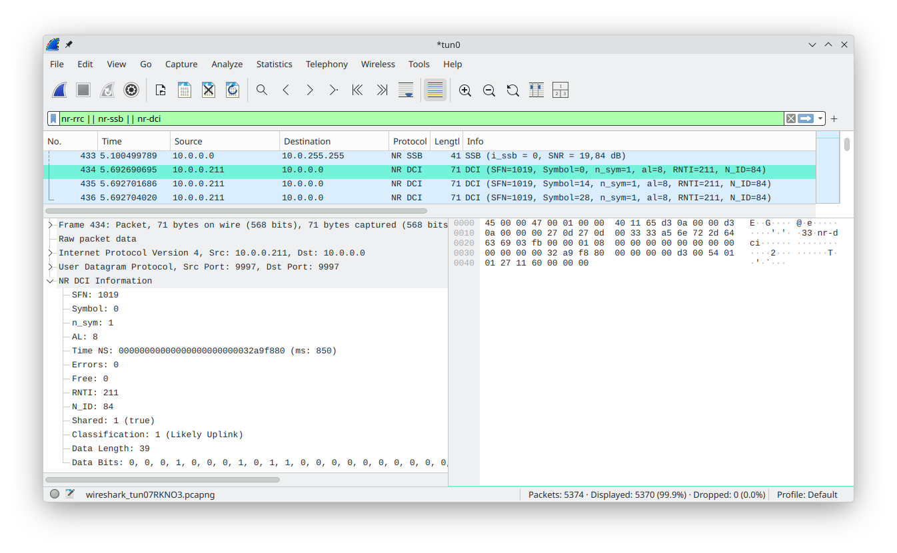

# 5GDescrambler

An open-source end-to-end binary DCI sniffer for 5G networks, featuring a novel technique exploiting algebraic structure on 5G physical downlink control channel (PDCCH), shipped with a full pipeline implementation in Rust.



## Installation and building

### Docker
We generally recommend using this repository with docker. 
You can either pull our pre-built docker image or build yourself.
This requires docker, and for building the `buildx` docker component to be installed.

#### Automatic setup
To perform setup automatically we recommend cloning this repository and executing the docker start script, which will automatically either pull or build the docker image and execute it:
```bash
git clone https://github.com/kit-ps/5GDescrambler.git 5GDescrambler
cd 5GDescrambler
bash start_docker.sh
```

#### Prebuilt
In order to use our prebuilt image, pull and execute it in the following way:
```bash
docker run --rm -it \
    -v "$(pwd)/evaluation:/app/evaluation" \
    -v "$(pwd)/descrambler/samples:/app/descrambler/samples" \
    -v "$SCRIPT_DIR/:/app/src" \
    --network=host \
    -v /dev/bus/usb:/dev/bus/usb \
    --privileged \
    "friwidev/5gdescrambler:latest"
```
In case you do not wish to use SDRs, you can remove the network, USB and privileged flags. The evaluation and samples mount are for evaluation and also optional.

#### Build
We recommend at least 32GiB RAM for compiling yourself. Building requires the `buildx` docker component to be installed. In order to build the container image yourself, clone this repository and build the image with:
```bash
git clone https://github.com/kit-ps/5GDescrambler.git 5GDescrambler
cd 5GDescrambler
docker build --network host -t 5gdescrambler .
```
You can then run the container like the docker image above (make sure to replace the image name).

### Local
#### Prerequirements
- For building we recommend at least 32GiB RAM (used while precomputing matrices and translating ASN.1 structures to rust).
- Please [install rust](https://rust-lang.org/tools/install/) and its requirements (clang), make sure to add rustfmt as component and install rust-script:
```bash
curl --proto '=https' --tlsv1.2 -sSf https://sh.rustup.rs | sh
rustup component add rustfmt
cargo install rust-script
```
- Please install soapysdr (including dev bindings), pkg-config and libfontconfig
```text
Arch: soapysdr pkgconf fontconfig
Debian: libsoapysdr-dev libsoapysdr0.8 pkg-config libfontconfig1-dev
```
- If you wish to test using an SDR, you also need to install your SDR driver, as well as the soapysdr module for it.

#### Compilation and installation
First pull this repository:
```bash
git clone https://github.com/kit-ps/5GDescrambler.git 5GDescrambler
cd 5GDescrambler
```

We recommend compiling using the current CPU as target:
```shell
RUSTFLAGS="-C target-cpu=native" cargo build --package descrambler --release
```

Alternatively, you can also compile to a non-CPU specific binary using:
```shell
cargo build --package descrambler --release
```

If you wish to install 5GDescrambler, you can add the resulting binary in `target/release/` to your PATH, or use `cargo install` instead of `cargo build` in the steps above. 
Furthermore, command completions for various shells are available by running:
```shell
./target/release/descrambler completions
```

## Usage instructions
### Testing from sample files
#### Sample acquisition
After successful installation, you can obtain our samples from our [dataset on Zenodo](https://doi.org/10.5281/zenodo.22659196). The samples can be extracted to the `descrambler` folder of this repository, replacing the existing folder.

#### Testing the samples

In order to test the samples, point 5GDescrambler to them with the correct band, e.g.:

```shell
descrambler waveform process file samples/5GSniffer_srsRAN/5g_sn_1 --band 71
descrambler waveform process file samples/OAI/oai_flood --band 78
```

To speed up configuration finding:

```text
--cf-super-fast-mode --cf-disable-error-correction
```

#### Output formats
Packets can be output to text (default), json, tun/tap devices and pcap (layer 2 and layer 3). Please note that the `--wireshark` flag is not supported in the docker images.

To output to json:
```text
-e json
```

To output to wireshark live using tun (requires wireshark to be installed and capability net admin on descrambler binary, do not run descrambler as root):
```text
sudo setcap cap_net_admin+ep /path/to/descrambler
-e tun -o tun0 --wireshark
```
Alternatively, in case of running into permission errors, you can also use wireshark with PCAP:
```text
-e pcap -o test.pcap --wireshark
```
If you wish to open wireshark manually, our custom DCI dissector can be found in [descrambler/wireshark/nr_dissector.lua](descrambler/wireshark/nr_dissector.lua).

### Processing from SDR

You can also decode live from SDR (please check for any legal restrictions in your country and adhere to them!):
```text
descrambler waveform process sdr --gscn <GSCN>
```
In case configuration is ambiguous, 5GDescrambler will ask for further parameters and provide possible values.
In case of not obtaining synchronization, try increasing the signal strength by moving closer to the target gNB and into a beam.
Also check with third-party tooling that your spectrum does not over-saturate and provides concise blocks at the frequency you expect transmissions.

### Encoding and decoding DCI

To test the decoding technique itself, you can encode and decode DCI using the command line:

```text
descrambler dci encode arg <aggregation layer> <cell id> <rnti> <n_id> <data>

If cell id is set to n_id, common search space is assumed. Else UE-specific search space is used.

Example:
descrambler dci encode arg 2 108 12345 54321 0 1 1 0 0 1 0 0
[INFO] success: Encoded DCI message: [1.0, 1.0, -1.0, -1.0, 1.0, 1.0, -1.0, 1.0, -1.0, 1.0, 1.0, -1.0, -1.0, 1.0, -1.0, -1.0, 1.0, 1.0, 1.0, 1.0, 1.0, -1.0, 1.0, -1.0, 1.0, 1.0, 1.0, -1.0, 1.0, 1.0, -1.0, -1.0, -1.0, 1.0, 1.0, -1.0, 1.0, -1.0, 1.0, 1.0, 1.0, -1.0, -1.0, 1.0, 1.0, 1.0, 1.0, 1.0, -1.0, 1.0, 1.0, -1.0, -1.0, 1.0, -1.0, 1.0, -1.0, 1.0, 1.0, 1.0, 1.0, 1.0, -1.0, -1.0, -1.0, 1.0, -1.0, 1.0, 1.0, 1.0, 1.0, 1.0, 1.0, -1.0, -1.0, -1.0, 1.0, -1.0, 1.0, -1.0, 1.0, 1.0, 1.0, 1.0, 1.0, 1.0, 1.0, 1.0, 1.0, -1.0, 1.0, -1.0, 1.0, -1.0, 1.0, 1.0, 1.0, -1.0, -1.0, -1.0, -1.0, -1.0, 1.0, -1.0, -1.0, -1.0, 1.0, -1.0, -1.0, -1.0, 1.0, 1.0, -1.0, 1.0, 1.0, 1.0, -1.0, -1.0, 1.0, -1.0, 1.0, 1.0, -1.0, -1.0, 1.0, -1.0, -1.0, -1.0, -1.0, 1.0, -1.0, 1.0, -1.0, -1.0, -1.0, 1.0, -1.0, -1.0, 1.0, 1.0, 1.0, -1.0, -1.0, -1.0, 1.0, 1.0, 1.0, -1.0, -1.0, -1.0, 1.0, -1.0, -1.0, 1.0, -1.0, 1.0, -1.0, -1.0, -1.0, 1.0, 1.0, 1.0, 1.0, 1.0, 1.0, 1.0, 1.0, -1.0, -1.0, -1.0, 1.0, -1.0, 1.0, -1.0, 1.0, -1.0, 1.0, 1.0, 1.0, 1.0, -1.0, 1.0, -1.0, 1.0, 1.0, 1.0, -1.0, 1.0, -1.0, -1.0, -1.0, 1.0, 1.0, -1.0, -1.0, -1.0, 1.0, -1.0, 1.0, -1.0, -1.0, 1.0, -1.0, 1.0, 1.0, -1.0, 1.0, -1.0, 1.0, -1.0, 1.0, -1.0, -1.0, -1.0, -1.0, -1.0]
```

To decode DCI use:
```text
descrambler dci decode arg <cell id> -- <LLRs>

Example using the data above:
descrambler dci decode arg 108 -- [1.0, 1.0, -1.0, -1.0, 1.0, 1.0, -1.0, 1.0, -1.0, 1.0, 1.0, -1.0, -1.0, 1.0, -1.0, -1.0, 1.0, 1.0, 1.0, 1.0, 1.0, -1.0, 1.0, -1.0, 1.0, 1.0, 1.0, -1.0, 1.0, 1.0, -1.0, -1.0, -1.0, 1.0, 1.0, -1.0, 1.0, -1.0, 1.0, 1.0, 1.0, -1.0, -1.0, 1.0, 1.0, 1.0, 1.0, 1.0, -1.0, 1.0, 1.0, -1.0, -1.0, 1.0, -1.0, 1.0, -1.0, 1.0, 1.0, 1.0, 1.0, 1.0, -1.0, -1.0, -1.0, 1.0, -1.0, 1.0, 1.0, 1.0, 1.0, 1.0, 1.0, -1.0, -1.0, -1.0, 1.0, -1.0, 1.0, -1.0, 1.0, 1.0, 1.0, 1.0, 1.0, 1.0, 1.0, 1.0, 1.0, -1.0, 1.0, -1.0, 1.0, -1.0, 1.0, 1.0, 1.0, -1.0, -1.0, -1.0, -1.0, -1.0, 1.0, -1.0, -1.0, -1.0, 1.0, -1.0, -1.0, -1.0, 1.0, 1.0, -1.0, 1.0, 1.0, 1.0, -1.0, -1.0, 1.0, -1.0, 1.0, 1.0, -1.0, -1.0, 1.0, -1.0, -1.0, -1.0, -1.0, 1.0, -1.0, 1.0, -1.0, -1.0, -1.0, 1.0, -1.0, -1.0, 1.0, 1.0, 1.0, -1.0, -1.0, -1.0, 1.0, 1.0, 1.0, -1.0, -1.0, -1.0, 1.0, -1.0, -1.0, 1.0, -1.0, 1.0, -1.0, -1.0, -1.0, 1.0, 1.0, 1.0, 1.0, 1.0, 1.0, 1.0, 1.0, -1.0, -1.0, -1.0, 1.0, -1.0, 1.0, -1.0, 1.0, -1.0, 1.0, 1.0, 1.0, 1.0, -1.0, 1.0, -1.0, 1.0, 1.0, 1.0, -1.0, 1.0, -1.0, -1.0, -1.0, 1.0, 1.0, -1.0, -1.0, -1.0, 1.0, -1.0, 1.0, -1.0, -1.0, 1.0, -1.0, 1.0, 1.0, -1.0, 1.0, -1.0, 1.0, -1.0, 1.0, -1.0, -1.0, -1.0, -1.0, -1.0]
[INFO] DCI {rnti = 12345, n_id = 54321, data = [0, 1, 1, 0, 0, 1, 0, 0, 0, 0, 0, 0], shared = false, errors = 0, free = 0}
Please note that data is padded with zeros to a minimum of 12 bits according to TS 38.212 Section 7.3.1.
```

### Further reference

Further command reference and all other functionality can be found using:

```shell
descrambler --help
```

## Open Science
### Reproducing evaluation

For reproducing our evaluation, we provide separate instructions [here](evaluation/README.md).

### Reuseability and Repurposability
Our artifacts are specifically designed to be reused and repurposed. 
To ensure reusability, we provide a docker image with 5GDescrambler pre-installed and SDR support, which are mounted as raw USB or network devices. 
Apart from this, our code follows a modular design, providing separate components that can be repurposed:
- Stream ingestion from either file or SDR via the [streaming ring buffer API](phys/src/pipeline/streamer.rs).
- Synchronization to SSB/PBCH via the [synchronization module](phys/src/pipeline/synchronization.rs).
- Frame extraction and OFDM processing via the [frame extraction module](phys/src/pipeline/frame_extractor.rs).
- SIB1 extraction and parsing via the [SIB1 finder module](phys/src/pipeline/sib1_finder.rs).
- Synchronization structure removal from grid and SNR estimation via the [synchronization analysis module](phys/src/pipeline/analyze_sync.rs).
- Merging of multiple input antennas using [Maximal-Ratio Combining](https://en.wikipedia.org/wiki/Maximal-ratio_combining) via the [grid merging module](phys/src/pipeline/merge_grids.rs).
- Active group detection and blind channel estimation via the [active group detection component](phys/src/pipeline/candidate/active_group_detection.rs).
- Candidate finding and sniffing via the [candidate finding and sniffing component](phys/src/pipeline/candidate/candidate_finding.rs).
- PDCCH [encoding](pdcch/src/encoder.rs) and [decoding](pdcch/src/decoder.rs) utilities using our technique in [pdcch crate](pdcch).
- [PDCCH](phys/src/pipeline/decode/ca_scl_polar_pdcch_known_params.rs) and [PBCH](phys/src/pipeline/decode/pbch.rs) polar decoding utilities using a [CA-SCL polar decoder](phys/src/pipeline/decode/ca_scl_polar.rs).
- Channel equalization and estimation using our [channel equalizer implementation](phys/src/equalization/channel_equalization.rs).
- Various 3GPP functions implemented throughout the codebase.

## Acknowledgements

In case `5GDescrambler` was useful for your work, please cite our publication as:
```bibtex
@inproceedings{windisch20265GDescrambler,
    author = {Windisch, Fritz and Strufe, Thorsten},
    booktitle = {Proceedings of the 2026 ACM SIGSAC Conference on Computer and Communications Security (CCS '26)},
    title = {5GDescrambler: Locating, Descrambling, and Decoding 5G Scheduling Information},
    year = {2026},
    doi = {10.1145/3830454.3846809},
    location = {The Hague, Netherlands},
    keywords = {5G, sniffing, scrambling, physical downlink control channel}
}
```
